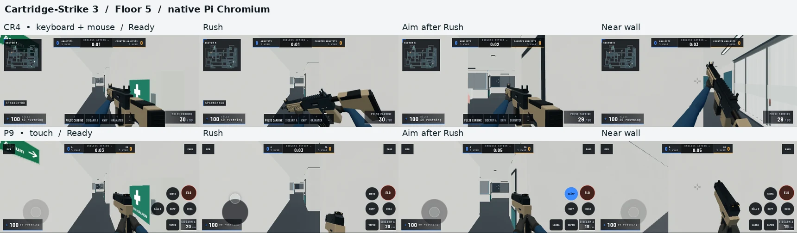

# First Rush slice on Floor 5

Both the CR4 and P9 fired on the seventh 60 Hz simulation tick after a press and release between render samples. Each of eight runs consumed one round and dispatched one local shot sound. The test exercised Chromium keyboard and mouse events and two simultaneous touch contacts on a Raspberry Pi 5. The movement stick entered Rush past its outer ring while the second finger pressed fire. A separate pass kept moving through Rush, requested ADS and reached an aim weight of 0.939 or greater.

The CR4 rolls its two-handed grip across the lower view. The P9 drops the trigger hand and releases the support wrist. In both cases the reticle disappears at full Rush and returns at ready. The wall comparison used a stationary player 0.33 m from a solid static face. Its upright tilt reached 0.598–0.606 radians with zero Rush weight. The running and wall poses correspond to V4/V6 and V1 respectively. [Recording review](../../RECORDING_REVIEW.md)

The probe clicked the existing Play control and used the Floor 5 world, normal input handlers, collision, rendering and audio dispatch. Its test fixture selected a corridor, equipped a weapon and drove deterministic 30 or 60 Hz render steps. Each device profile exercised both rates, both weapons and Reduced Motion on and off. The paired-pose unit test checked that Reduced Motion keeps the lowered silhouette and free wrist fixed across different stride phases. The reported 116.67 ms measures simulation recovery. Physical display latency and acoustic onset require device measurements. [Per-run results](result.json)

Two real SDK seats also received the same original shot angle after the shooter released and turned. An ordered WebSocket proxy applied 125 ms of delay and ±20 ms of jitter in each direction. In a run with 257 ms measured RTT, an eligible press arrived at age 446 ms. The shot used current-world collision when its 500 ms history window expired during recovery. The shooter spent one round and the observer received one shot. The tests also check that a sample already 520 ms old at admission is rejected and that duplicate controls and fire IDs cannot replay the action. [Authority tests](../../../../server/test/rush.test.mjs)

Reproduce the branch contract with `npm run build --prefix server -- --check`. Run the focused simulations with `node --experimental-loader ./tools/vendor-three-test-loader.mjs --test src/fps/rush.test.mjs` and `node --import ./server/register-shared.mjs --test server/test/rush.test.mjs`. On the Pi's Wayland display, run `node --import ./server/register-shared.mjs tools/rush-browser.mjs` to produce the PNG sequence and per-frame traces in a private temporary directory. The graphics runs used Chromium 156, Broadcom V3D, 844 × 390 CSS pixels, device scale 0.75 and low graphics. The gameplay branch still used the CS2 interface during these captures. [Render probe](../../../../tools/rush-browser.mjs)

The next handling slice covers sight alignment, the visible pistol wrist, slides, gamepad controls and manual cartridge release. [Movement and held-item handling](handling.md)
