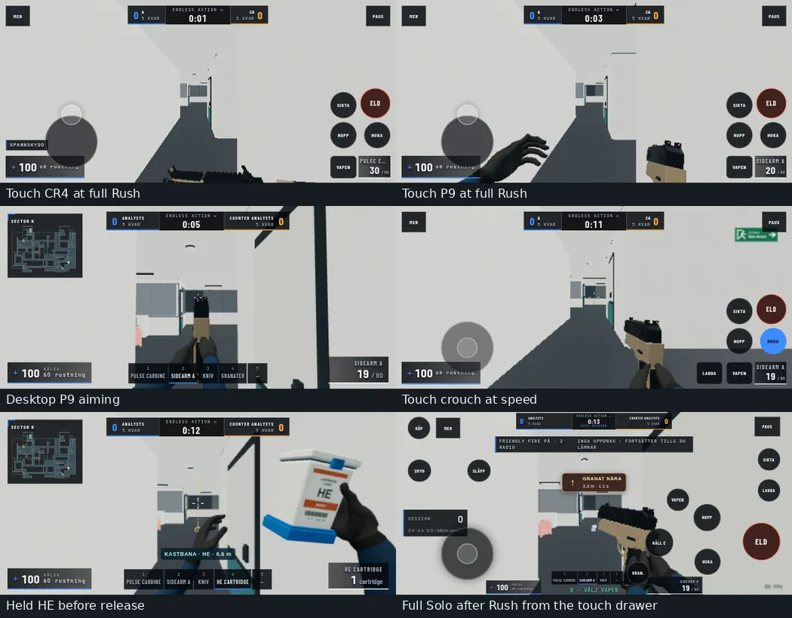
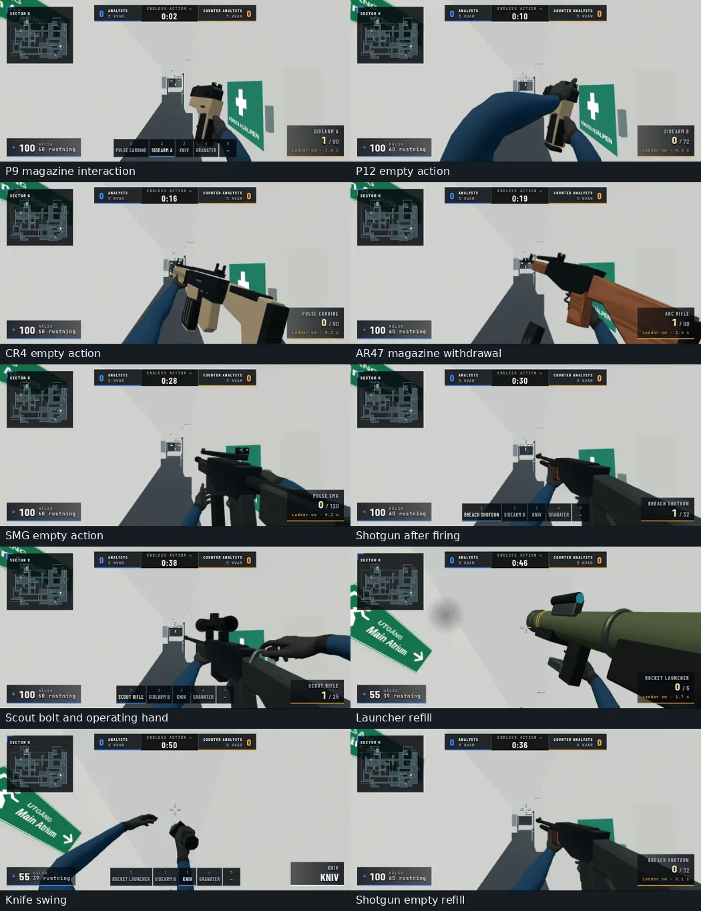
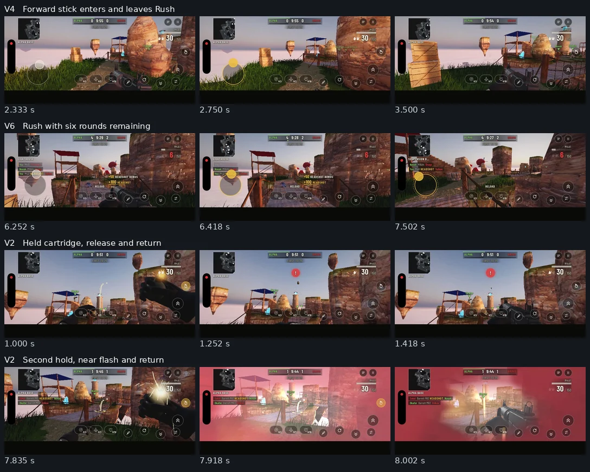

# Movement and held-item handling

The integrated English client adds real-time touch video timing, family sound and casing observations, and matched events from two connected seats. [Integrated handling verification](integration.md)

The CS3 control path enters Rush from forward input and actual resolved movement. While rushing, press Ctrl, the touch crouch button, or B on a standard gamepad to slide. The existing capsule sweep resolves each step. Releasing the stick and pressing crouch in the same input sample preserves the last resolved Rush impulse. A held crouch stays low after the slide. A blocked capsule ends the slide, and a jump requires standing clearance. The authoritative state and movement replay share the direction, speed, end time and cooldown. The source for the decaying speed curve and limited steering is Riposte's 07c-controller. [Recording comparison](../../RECORDING_REVIEW.md)

P9 and P12 bring their authored front and rear marks to screen center in ADS. The ordinary long guns align their sights or optic, and each model retains its own shot response. The pistol runner releases the support wrist into the lower-left view while the trigger hand stays on its grip. All 13 held items keep the central ray clear at rest and across a full Rush stride. The two-handed reloads still attach the support palm to the animated magazine or shell. [Grip and projection tests](../../../../src/fps/view-grips.test.mjs)

Selecting a cartridge and holding the manual trigger begins its pull. A quick tap finishes the pull before releasing one projectile. HE starts its 1.8 s fuse when it has been held for 0.42 s. Flash and smoke keep their full fuse until launch. Releasing a live HE preserves its existing deadline. Holding it until expiry causes a blast at the holder. Switching, dying or losing controls before HE starts cooking cancels the pull. The same interruptions drop a live HE at the player's position. Selecting a firearm during a pull or cook requires releasing the trigger before it can fire. Match and round boundaries clear transient state. The guide's ring marks predicted detonation and accounts for the remaining fuse and release animation. If the in-hand fuse will expire by the attainable release tick, the guide hides the outward path and displays the in-hand countdown immediately. The reference is Riposte's 08-player; the projectile, collisions, effects, and inventory use CS's existing simulation. [Shared simulation tests](../../../../src/fps/rush.test.mjs)

A standard gamepad uses the left stick to move, the right stick to look, L3 to start Rush, B to crouch or slide, and A to jump. LT aims and RT fires or holds a cartridge. X reloads, Y cycles weapons, RB selects a cartridge, LB interacts and D-pad left inspects the selected item. The touch stick still triggers Rush at the outer ring. The touch utility drawer offers Rush and Inspect in Clean and Full. The Full HUD keeps Buy and Pause independently reachable. Stick response, dead zones and trigger hysteresis adapt the reference 09qc-manette and 09q-tactile controls. The automated gamepad test supplies standard-layout button and axis samples. Physical controller and phone testing remain open.

Reproduce the focused simulation, grip, grenade and precision tests with `node --import ./server/register-shared.mjs --test --test-concurrency=1 src/fps/rush.test.mjs src/fps/view-grips.test.mjs tools/grenade.test.mjs tools/precision.test.mjs`. Protocol 16 retains the existing actor fields and stores slide and cartridge state in a typed child to fit Colyseus's 63-field actor limit. Client prediction restores the nested movement snapshot on adoption. The live room probe uses two SDK connections and observes both authoritative slide snapshots and the cartridge fuse across control loss. The browser probe enters through Play and uses the normal mouse, keyboard and touch controls. [Room probe](../../../../server/test/rush.test.mjs) · [Browser probe](../../../../tools/rush-browser.mjs)

The final protocol 16 run used Chromium 156.0.8078.79 on the Pi's V3D 7.1.10.2. At 0.936 Rush weight, the CR4 tip starts at 90.2% of viewport height (90.8% in reduced motion). P9's left wrist is visible at approximately (-0.42, -0.70) in normalized device coordinates. The modelled P9 front sight is within 0.011 of center horizontally after recovery. Each of eight 30/60 Hz keyboard or touch runs spent one round and dispatched the matching shot sound at the same simulation time. Desktop and touch entered the resolved slide at 9.114 m/s, held one live HE, then cast exactly one and returned to P9. Touch opened Inspect and triggered Rush through the Full Solo drawer, with More, Buy and Pause each passing a separate center hit test. A real two-seat SDK room reproduced both early and cooked switch interruptions, sustained held-trigger suppression and a single new-press shot. [Machine-readable receipt](handling-result.json)

These captures are from the focused handling branch before the English frontend was integrated. Touch uses emulated multitouch in Chromium. The shot receipt measures the audio dispatch callback. Audible near/far recordings are a separate integrated gate.

## Family captures

An Endless session exercised all eight firearms with actual numeric selections, mouse presses and R. The seven multi-round magazines entered a tactical reload, switched to the knife to interrupt it, reselected the firearm and fired the remaining round. The retained reserve and the unchanged pre-reload magazine were checked after the original deadline. Each empty reload completed with conserved ammunition. The launcher has a single-round magazine. The same session fired its one rocket, displayed the refill and restored one round. The knife's swing and return were captured after selecting it normally. The Scout uses the reference 06d bolt rotation, travel and moving right-hand contact after each confirmed shot. AR47, SMG, Scout and shotgun have distinct empty-only finishing movements on the existing authoritative deadlines. [Family probe](../../../../tools/handling-family-probe.mjs)

For the additional capture run `WAYLAND_DISPLAY=wayland-0 FAMILY_CAPTURE=1 RUSH_OUTPUT=/tmp/cs3-family node --import ./server/register-shared.mjs tools/rush-browser.mjs desktop` with an existing output directory and the local Playwright dependency.

## Recording comparison and remaining package gates

V4 shows the thumb go from neutral to gold, the rifle tip moving against the lower edge, and the reticle returning after release. V6 repeats the stick transition while the red six-round indicator and reload prompt remain on screen. V2 shows the first projectile in flight and the rifle returning, followed later by a held cartridge, a near white flash and a red damage edge. The second sequence contains no visible release. These are timestamped frames from the uploaded videos. Their original hashes, durations and audio analysis are in the [recording inventory](../../RECORDING_REVIEW.md).

| Held family | Evidence on this branch | Evidence still required on the integrated build |
| --- | --- | --- |
| P9 / P12 sidearms | Both authored front marks are visible through the centered rear opening. The native P9 run sampled a full Rush, a released tap and ADS at 30 and 60 Hz. | Match these local tactical cancellation and empty completion frames with recorded foley, shell and remote event onset. |
| CR4 / AR47 / SMG | Centered sights and clear central view on all three meshes. CR4 has real keyboard and touch Rush, recovery, near-wall control and a two-seat short-tap trace. | Join the final long-gun sprint-to-reload transition and the recorded tactical cancellation and empty completion to near and far audio. |
| Shotgun / scoped rifle / launcher | The native sequence measured the moving pump, captured the right hand on the Scout bolt and fired and refilled the one-round launcher. Fixed-step grip tests verify slide, bolt, shell and launcher contact. | Join local pump or bolt motion, scoped entry/exit, and launcher fire/reload to remote effect counts and audible timing. |
| HE / flash / smoke | Live HE pull, hold and release, full-fuse flash/smoke and cooked HE deadlines have explicit fixed-step tests. Two SDK peers traced the held fuse and interrupted drop. | Capture normal and interrupted actions across both clients, including flash/smoke in the modes that supply them, final in-hand warning and audible onset. |
| Knife / mission bomb | Both held models passed the ready and Rush center-ray checks. Native keyboard/mouse also selected the knife and captured a confirmed swing and recovery. | Capture melee recovery, Classic objective interruption, and switch/inspect return on both input paths. |

The roadmap also calls for matched stock CS2, standalone Riposte and integrated CS3 recordings on the same hardware and settings. This handling slice supplies geometry, input, timing, and event evidence. The synchronized family recordings, audible near/far onset, V6 feedback under overlapping flash/low ammo, and the integrated Classic/Endless regression run remain package verification work. [CS3-02 roadmap](../../IMPLEMENTATION_ROADMAP.md)
