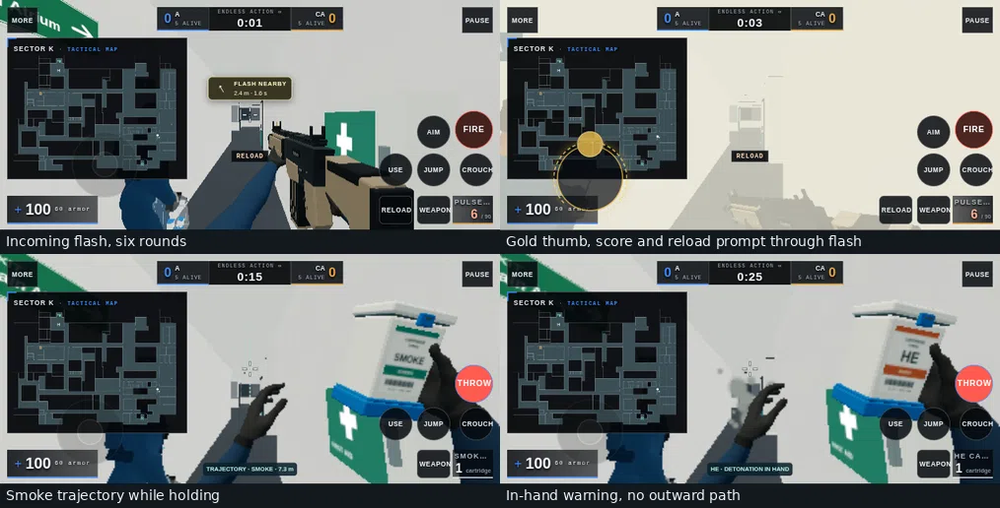
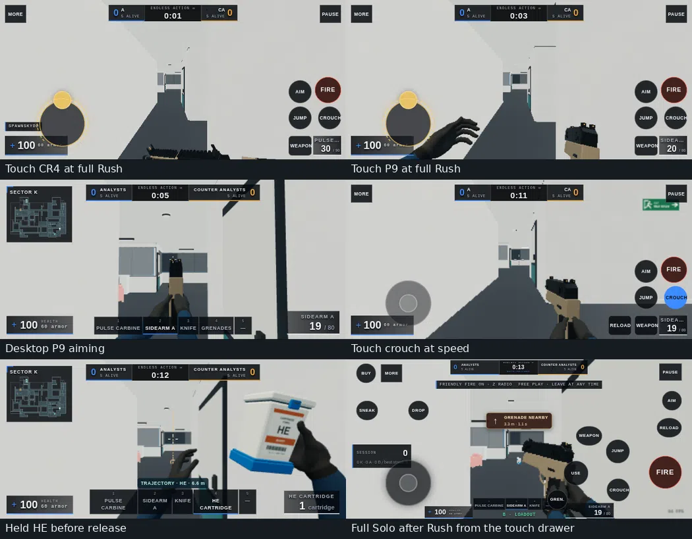
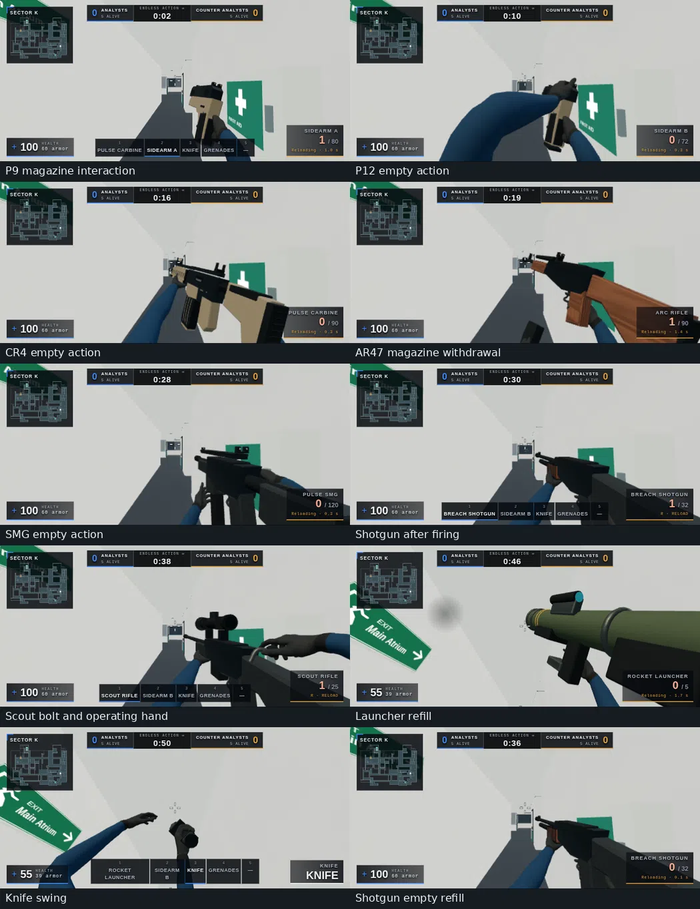

# Integrated handling verification

The Raspberry Pi ran the English Play → Solo → Endless path with multitouch, then with keyboard and mouse. Each uncut recording begins with a ready CR4, proceeds through Rush, spends one round, shows the incoming flash, starts Rush again while six rounds remain and reloads to 30. The fixture supplies initial stock, an open lane and the other actor's flash throw. The game's own movement, damage rules, input, projectile, fuse, HUD, renderer and audio graph handle the actions. [Touch recording](v6-touch.webm) · [Keyboard and mouse recording](v6-keyboard.webm) · [Timing and family receipts](integrated-handling.json)

| Input | Duration | Compositor frames | Render samples with Rush above 0.65, active flash and six rounds | In-game prompt |
| --- | ---: | ---: | ---: | --- |
| Multitouch | 7.052 s | 216 | 14 | RELOAD |
| Keyboard and mouse | 6.590 s | 200 | 11 | R · RELOAD |

The capture uses each submitted Chromium compositor frame from the running tab and an Opus recording of the same tab's master audio bus. A variable-frame-rate VP9 encode preserves the durations on a millisecond time base. Both files have 633 × 293 video and 48 kHz stereo audio. The 120 ms Hann windows in the decoded touch file put the ring peak at 3108.3 Hz, 0.10 to 1.60 s after the real flash event. In the same windows the peak falls from −34.6 to −59.2 dBFS. The keyboard file showed −35.3 to −59.1 dBFS. The source V6 survey measured 3108.45 to 3109.19 Hz. The recordings include ordinary game sounds during the decay. Their checksums, per-event timings, neighboring frequency bands and simulation samples are in the receipt. [Source audio measurements](../audio/v6-source-band.json) · [Capture driver](../../../../tools/handling-sequence-probe.mjs)

The earlier native V6 run exposed a clipped 48 px ammo panel and an expanded tactical map overlapping a team score. The corrected mobile frame retains the six-round counter, the prompt below center, both team scores, the outer gold thumb and the action controls. The player can select **Reduced flash and ringing** in Pause. On the same simulated throw, toggling this setting changed peak visual opacity from 0.753 to 0.361. Each run entered Rush during the flash at weight 0.723. The prompt stayed within the 844 × 390 viewport at x 390.9–453.1, y 255.6–274.8. The same captures use the normally rendered minimap, warning and score. [V6 touch probe](../../../../tools/handling-overlap-probe.mjs)



Eight additional 30/60 Hz input profiles used Chromium 156.0.8078.79 on the same Pi V3D 7.1.10.2. The English Full Solo touch drawer exposed Inspect and Rush, with independent hit targets for More, Buy and Pause. Both input families entered the slide on a real crouch tap, held one live HE and released one projectile before returning to P9. Each Rush-to-fire profile spent one round. The normal CR4 tip settled at 90.2% of viewport height during full stride. The P9's modeled front sight settled 0.0101 normalized units right of center after the 30 Hz Rush-to-aim transition. The reduced-motion runs, ready and near-wall cases retained the controls and aligned sights. [Per-profile input, rendering and aim results](integrated-poses.json)



A separate keyboard and mouse Endless session on the same integrated build selected and fired P9, P12, CR4, AR47, SMG, shotgun, Scout and launcher. Both sidearms and all five multi-round primaries interrupted a tactical reload by switching to the knife, spent the retained round and completed an empty reload. The launcher discharged and refilled its single slot. Every selection delivered the confirmed shot to local audio on the same simulation tick. Each of the seven conventional firearms played two distinct decoded first-person shot recordings. The launcher uses the separate rocket launch event for its sound. Each sidearm played its recorded magazine withdrawal twice, insertion once and empty slide once across the canceled and completed attempts. The seven guns that eject a case each produced one. The launcher produced zero. The Scout and shotgun pool their case until the visible bolt or pump stroke. Each also started two real decoded mechanical voices in the sequence, one for the initial firing cycle and one for the empty reload. The second firing cycle was interrupted by reloading. The separate knife input produced one swing and returned to ready. [Family probe](../../../../tools/handling-family-probe.mjs) · [Rocket playback receipt](../01-menu/rocket-browser-receipt.json)



Two connected SDK seats saw identical shot action IDs and event IDs for all eight firearms and the same authoritative one-round debit. In a separate 250 ms round-trip configuration with 20 ms jitter, a short manual Rush tap produced one accepted shot and one debit. All 80 combined simulation, grip, physical-effect, foley, input and room checks passed on this integrated runtime. At the following revision the complete 14-test sender fixture passed after scoping the HE hold bit to an equipped, stocked cartridge. Real SDK tests then confirmed that early and cooked HE interruptions still require a new trigger press after the rifle returns. Both seat and simulation tests use the ordinary rifle fire level after the switch. [Authority tests](../../../../server/test/rush.test.mjs)

The real touch cartridge selector held and returned both smoke and flash to the CR4. Both retained their full 1.8 s fuse until launch. The guide endpoint matched each simulated detonation within 0.03 m. With 0.087 s left on a held HE, the display showed **HE · DETONATION IN HAND**, removed the outward trajectory and applied the eventual blast at the holder's location. [Touch cartridge probe](../../../../tools/handling-cartridge-probe.mjs)

Solo supplies smoke, flash and HE. The current private Classic shop and private Endless equipment rules supply HE. The room replicates that cartridge's fuse and release. The visual flash overlap and its ringing are a Solo measurement. Native touch measurements use Chromium multitouch emulation. The focused gamepad fixture supplies standard controller axes and buttons. Physical phone and controller checks remain open.


## Matched Pi route

The candidate repeated the original CS3-00 normal-entry benchmark with three desktop and three emulated multitouch runs. Chromium used the Pi's V3D, low graphics, 76° base FOV, an 844 × 390 CSS viewport and device scale 0.65. Both CS games ran the same Floor 5 Endless route, AR47, ten combatants and the original profile's resident count. The standalone Riposte run uses its Khamsin course and original rifle. Each repeat first measures 10 s of stationary forward-view pacing, then issues ordinary movement, explicit Rush where available, a fire request during motion, and reload. Every candidate repeat completed its full magazine refill and recorded zero page errors. [Candidate run receipts](matched-client.json) · [Original paired measurements and reproduction method](../../baseline/performance/README.md)

The table gives the range across three repeats, in milliseconds. The Rush column measures input timestamp to the first completed render above 2% blend. The shot column ends at the first completed render with fewer rounds. The sound column ends at local Web Audio source scheduling. The games and different audio/output devices have independent rendering and playback schedules.

| Client and input | Frame p50 | Frame p95 | Frame p99 | Rush visible | Shot visible | Shot sound scheduled | Full reload |
| --- | ---: | ---: | ---: | ---: | ---: | ---: | ---: |
| Stock CS2 desktop | 71.8–73 | 91.4–96.5 | 95.8–117 | — | 85.3–147.4 | 28.0–54.0 | 2674.7–2787.9 |
| Stock CS2 touch | 63.8–70.1 | 78.3–83 | 108.6–111 | — | 206.6–298.7 | 136.7–162.2 | 2593.0–2800.5 |
| Riposte desktop | 47.2–49.4 | 67.4–76 | 81.1–127.2 | 37.5–54.5 | 135–206.7 | 103–163.9 | 2032.1–2062.0 |
| Riposte touch | 43.2–43.7 | 61.1–64.9 | 72.7–78.4 | 116.9–155.3 | 239.3–302.2 | 207.2–274.9 | 2070.9–2114.0 |
| CS3 desktop | 63.4–65.6 | 79.3–91 | 95.2–106.8 | 108.3–112.1 | 138.2–246.8 | 101.5–130.6 | 2320.4–2346.0 |
| CS3 touch | 62.3–64.8 | 77–79.2 | 98.4–101.8 | 220.2–317.0 | 250.7–387.6 | 202.4–234.8 | 2392.6–2416.3 |


The CS3 forward-view median and p95 fell within or below the stock CS2 ranges on both inputs. The donor had lower median frame times and faster visible Rush entry. The cold CS3 firing frame reached 246.8 ms on desktop and 387.6 ms on touch. The warm touch repeats were 250.7 and 291.4 ms. The cold touch shot sound was scheduled at 234.8 ms, before its first observed ammunition render. The ready gate is intentional and separately verified at 60 Hz. The six real-time measurements also include event delivery, simulation scheduling and rendering. More detailed scheduling and physical input/display measurements are open performance work. None of these three games reached a 33.3 ms median on the measured forward view.

Reproduce from the project root on the Pi with an existing temporary output directory. Run the two commands serially.

```sh
WAYLAND_DISPLAY=wayland-0 CS3_BENCH_OUT=/tmp/cs3-pacing node docs/cartridge-strike-3/baseline/performance/compare.cjs candidate desktop 3
WAYLAND_DISPLAY=wayland-0 CS3_BENCH_OUT=/tmp/cs3-pacing node docs/cartridge-strike-3/baseline/performance/compare.cjs candidate touch 3
```
